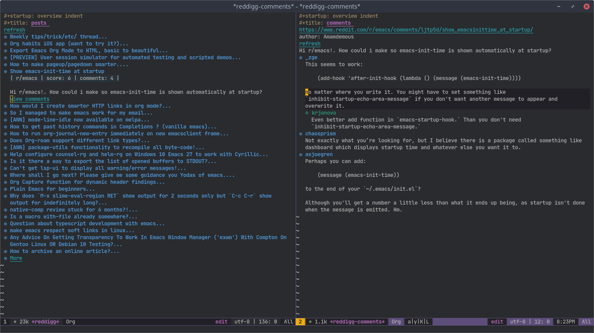
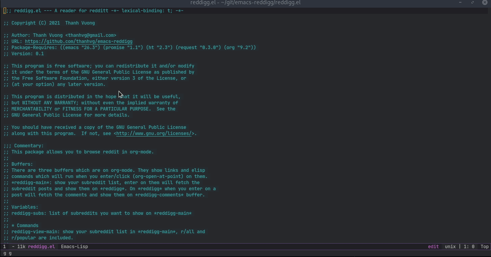

#+STARTUP: content indent
#+title: View Reddit in Emacs org-mode

[[http://spacemacs.org][file:https://cdn.rawgit.com/syl20bnr/spacemacs/442d025779da2f62fc86c2082703697714db6514/assets/spacemacs-badge.svg]]

* Intro

This package lets you browse Reddit in Emacs org-mode.

It also lets you vote, reply, edit, delete, and submit posts.

Reddit requests now require a logged-in browser session for these actions.

~reddigg.el~ talks to a small local Python server.

The server relays each request to a userscript running in your logged-in Reddit tab.

#+begin_example
Emacs  <--HTTP-->  server/reddigg_server.py  <--websocket-->  userscript in Reddit tab
#+end_example

The tab performs the request with your own session, so no API keys are needed.
* breaking change version 0.9.0: no longer depends on ~browser-gt~
use ~browser-gt~ branch if you prefer it.

* Requirements

- Emacs 26.3 or later.
- ~promise~ 1.1 or later.
- ~ht~ 2.3 or later.
- ~org~ 9.2 or later.
- [[https://docs.astral.sh/uv/][uv]], which runs the server and installs its dependencies from ~server/pyproject.toml~.
- A userscript manager such as Tampermonkey or Violentmonkey.
- A logged-in Reddit session in the browser.

* Setup

1. Install the required Emacs packages.
2. Start the server: ~cd server && uv run reddigg_server.py~.
3. Install ~userscript/reddigg-ws.user.js~ in your userscript manager.
4. Log in to Reddit and open an ~old.reddit.com~ tab.
5. Allow the connection when the browser prompts for permission.
6. Check that the toggle button at the bottom right corner shows connected.
7. Load ~reddigg.el~ in Emacs.
8. Run ~M-x reddigg-ping~ to check the whole chain.

The browser asks for permission because the userscript connects to ~127.0.0.1~.

Choose to always allow it, or the prompt returns on each page load.

The server listens on ~127.0.0.1:1979~ only.

Use ~--port~ to change the port.

The userscript uses port 1979 unless the page URL has ~?reddigg_ws_port=PORT~.

* Server and userscript

The server creates a secret token in =~/.config/reddigg/token= on first run.

~reddigg.el~ reads it and sends it in the ~X-Bridge-Token~ header.

Set ~REDDIGG_TOKEN_FILE~ to use a different token file.

The userscript adds a button that shows the connection state: grey is connecting, green is connected, orange is reconnecting.

Click the button to toggle the connection to the server.

The server accepts websocket connections from ~reddit.com~ origins only.

Use ~--origin~ to allow others, ~--repl~ for an interactive prompt, and ~-v~ for debug logs.

If several tabs are connected, the most recently active one is used.

* Buffers

~*reddigg-main*~ shows your subreddit list.

~*reddigg*~ shows posts from a subreddit.

~*reddigg-comments*~ shows comments for a post.

The buffers use org-mode.

Enter on a Reddit link to run its Emacs command.

* Variables

~reddigg-subs~ lists the subreddits for ~*reddigg-main*~.

~reddigg-server-url~ is the server's base URL.

The default is ~http://127.0.0.1:1979/reddigg~. Change it if you use ~--port~.

~reddigg-token-file~ is the path to the server token.

The default follows ~REDDIGG_TOKEN_FILE~, then ~$XDG_CONFIG_HOME/reddigg/token~, then =~/.config/reddigg/token=.

~reddigg-request-timeout~ sets how many seconds Emacs waits for one request. The default is 35.

* Commands

~reddigg-view-main~ shows your subreddit list.

~reddigg-view-sub~ prompts for a subreddit and shows its posts.

~reddigg-view-frontpage~ shows the front page from ~reddigg-subs~.

~reddigg-view-comments~ prompts for a post and shows its comments.

~reddigg-submit-post~ starts a new post.

~reddigg-ping~ checks that the server is up and a Reddit tab is connected.

~reddigg-refresh-session~ reloads the logged-in username after a login change.

* Read posts

1. Run ~reddigg-view-main~.
2. Select a subreddit.
3. Select a post.
4. Enter on ~view comments~ to open its comments.

* Vote

Use these keys in a ~reddigg~ buffer.

- ~C-c C-v u~: upvote.
- ~C-c C-v d~: downvote.
- ~C-c C-v 0~: clear the vote.

The score updates in the current buffer.

* Reply

1. Place point on a post or comment.
2. Press ~C-c C-v r~.
3. Write the reply.
4. Press ~C-c C-c~ to send it.
5. Press ~C-c C-k~ to abort.

The new comment appears under its parent.

* Edit

1. Place point on your post or comment.
2. Press ~C-c C-v e~.
3. Edit the text.
4. Press ~C-c C-c~ to save it.
5. Press ~C-c C-k~ to abort.

~reddigg~ rejects edits for content from another user.

Link posts do not have editable post text.

* Delete

1. Place point on your post or comment.
2. Press ~C-c C-v x~.
3. Confirm the delete prompt.

~reddigg~ rejects deletes for content from another user.

* Submit a post

1. Run ~reddigg-submit-post~.
2. Enter the subreddit name.
3. Select ~self~ or ~link~.
4. Enter the post title.
5. Write the post body or link URL.
6. Press ~C-c C-c~ to submit.
7. Confirm that you want to view the new comments.

For a ~self~ post, enter the post text.

For a ~link~ post, enter the link URL.

~reddigg~ reports the new post ID and URL after a successful submit.

* Compose buffers

~reddigg-compose-mode~ handles reply, edit, and submit buffers.

Press ~C-c C-c~ to send the current compose buffer.

Press ~C-c C-k~ to abort the current compose buffer.

* Reddit session

Write actions use the Reddit session in the userscript tab.

The userscript reads the CSRF token and username from the Reddit page.

~reddigg-refresh-session~ refreshes these values after a login change.

* Remarks

~reddigg~ uses the Reddit API through the userscript running inside the Reddit tab.

Keep the Reddit tab open and logged in while you use ~reddigg~.

For a complete Reddit client, see [[https://github.com/ahungry/md4rd][md4rd]].
